<p align="center">
  
</p>

<h1 align="center">CeraLab — strona marki</h1>

<p align="center">
  Jednostronicowa, w pełni animowana strona marki kosmetycznej <strong>CeraLab</strong> — pielęgnacja z ceramidami dla skóry wrażliwej i suchej.<br>
  Rytuał w trzech krokach: <em>oczyść → odbuduj → zabezpiecz</em>.
</p>

<p align="center">
  
  
  
  
  
</p>

---

## Podgląd

> Zrzuty z wersji deweloperskiej (1440 × 900 i 390 × 844). Animacje — wejścia tekstu, przypięta sekcja produktów, paralaksa — najlepiej zobaczyć po [uruchomieniu lokalnie](#uruchomienie).

### Hero z wideo

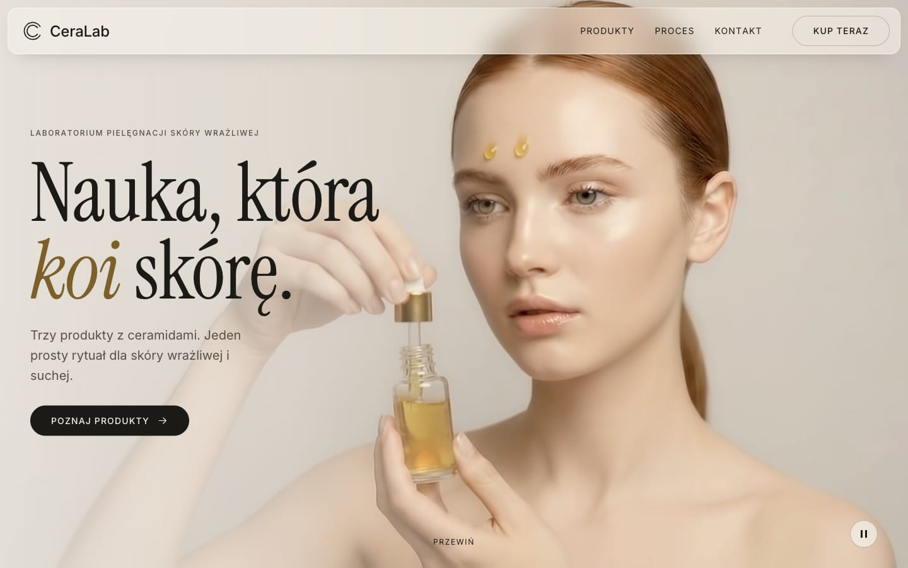

### Produkty, proces i kontakt

<table>
  <tr>
    <td width="50%">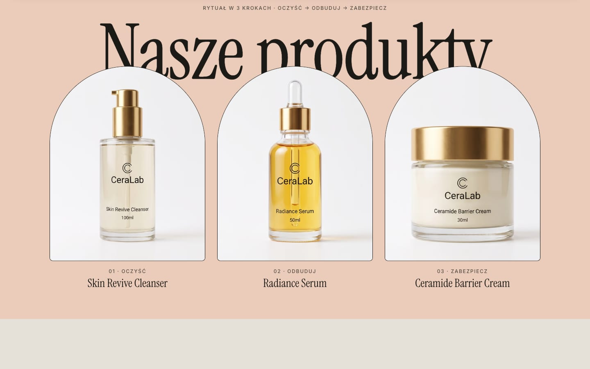</td>
    <td width="50%">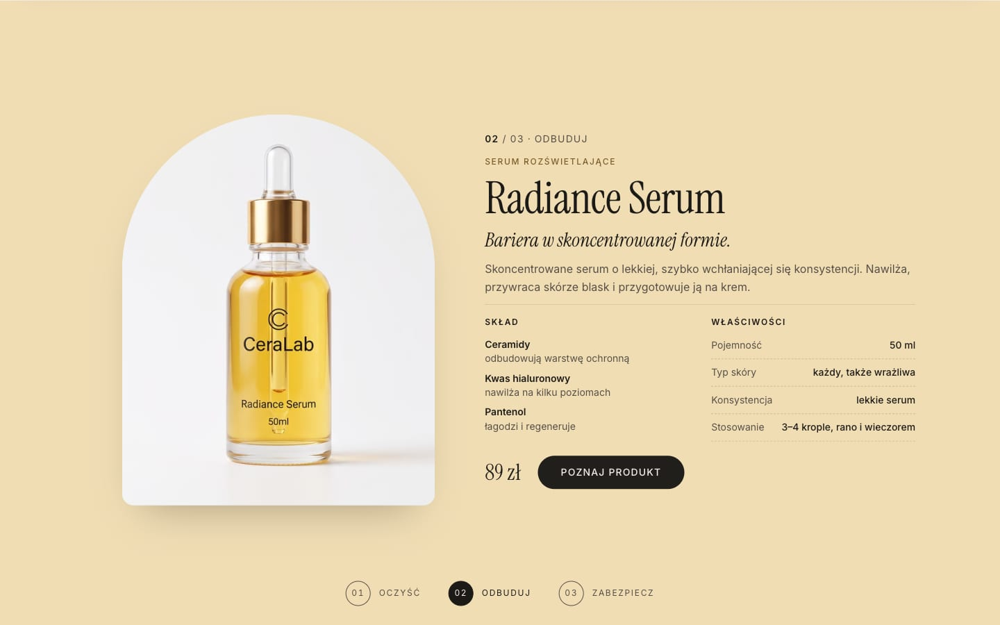</td>
  </tr>
  <tr>
    <td align="center"><sub><b>Nasze produkty</b> — łuki wyjeżdżają spod nagłówka</sub></td>
    <td align="center"><sub><b>Karta produktu</b> — skład, właściwości, cena; tło zmienia kolor</sub></td>
  </tr>
  <tr>
    <td width="50%">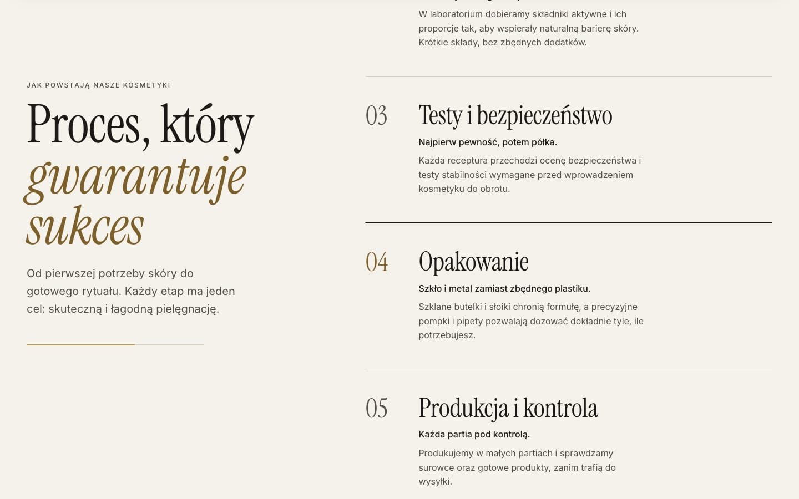</td>
    <td width="50%">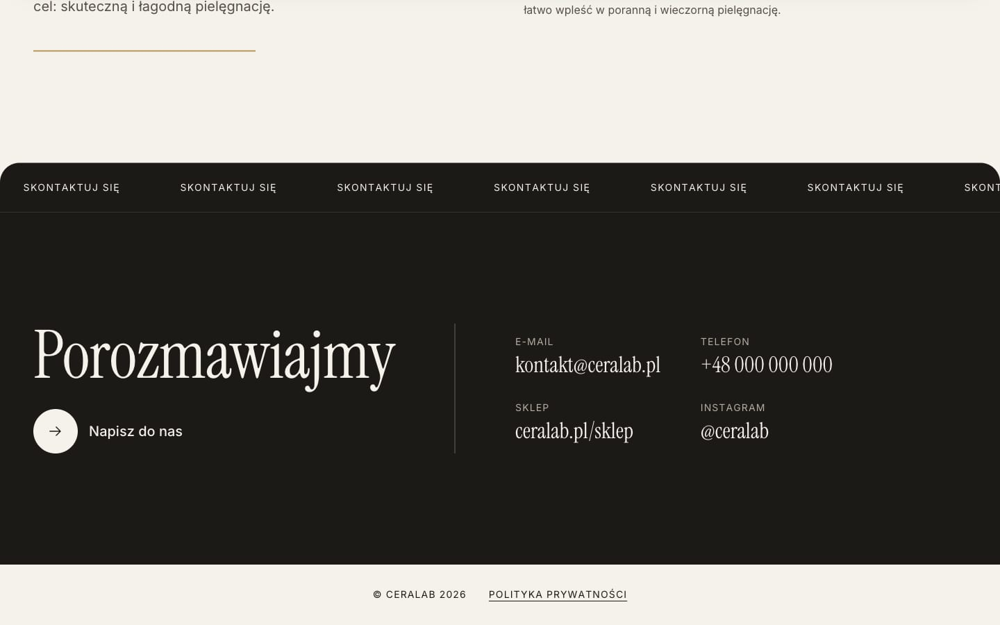</td>
  </tr>
  <tr>
    <td align="center"><sub><b>Proces, który gwarantuje sukces</b> — 6 kroków z paskiem postępu</sub></td>
    <td align="center"><sub><b>Kontakt</b> — nieskończony pasek i dane kontaktowe</sub></td>
  </tr>
</table>

### Podstrony

<table>
  <tr>
    <td width="50%">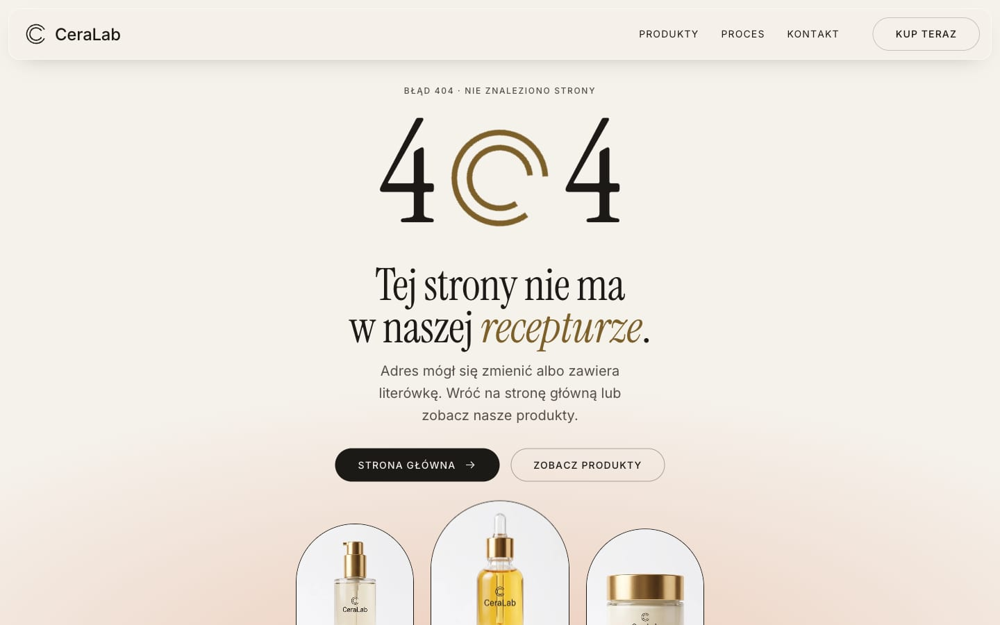</td>
    <td width="50%">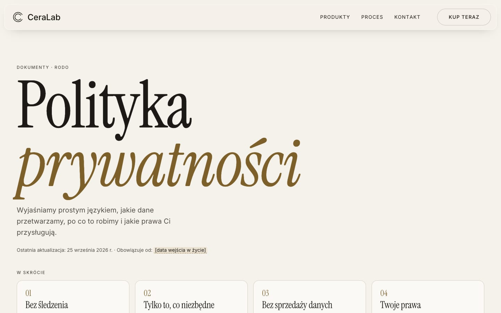</td>
  </tr>
  <tr>
    <td align="center"><sub><b>404</b> — zero to rysujący się znak z logo</sub></td>
    <td align="center"><sub><b>Polityka prywatności</b> — najważniejsze informacje w pigułce</sub></td>
  </tr>
  <tr>
    <td colspan="2">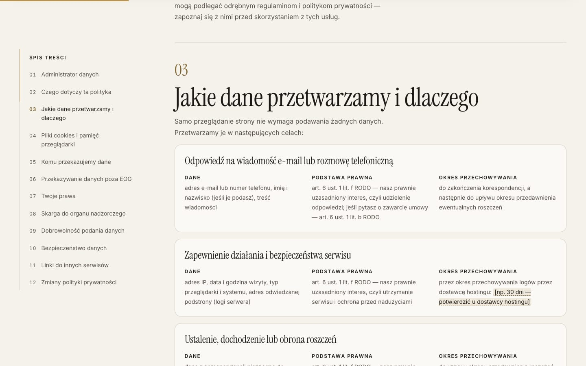</td>
  </tr>
  <tr>
    <td colspan="2" align="center"><sub><b>Polityka prywatności</b> — przyklejony spis treści z podświetleniem, pasek postępu czytania, cele przetwarzania jako karty</sub></td>
  </tr>
</table>

### Telefon

<table>
  <tr>
    <td width="25%">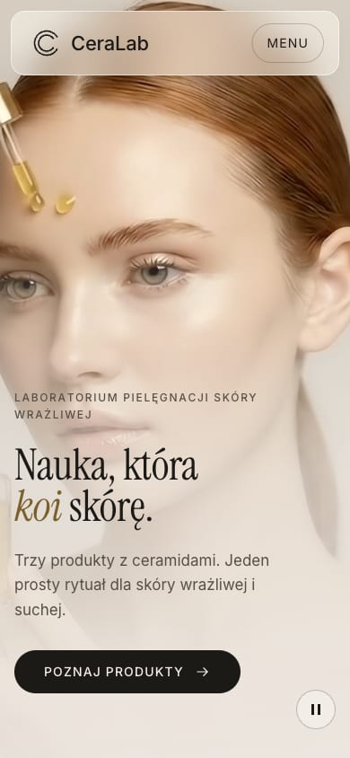</td>
    <td width="25%"></td>
    <td width="25%">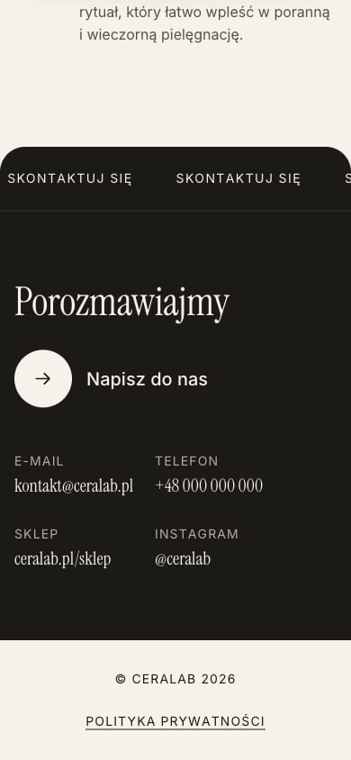</td>
    <td width="25%">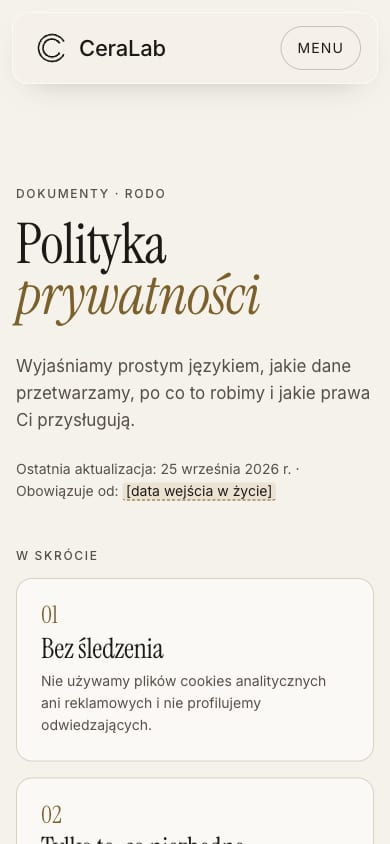</td>
  </tr>
  <tr>
    <td align="center"><sub>Hero</sub></td>
    <td align="center"><sub>Produkt</sub></td>
    <td align="center"><sub>Kontakt</sub></td>
    <td align="center"><sub>Polityka</sub></td>
  </tr>
</table>

---

## Co jest na stronie

| Sekcja | Co robi |
|---|---|
| **Preloader** | Znak „C” rysowany obrysem + licznik 0 → 100%, kurtyna w górę. Przy kolejnej wizycie w tej samej karcie skrócony do ~0,6 s. |
| **Hero** | Pełnoekranowe wideo w tle, nagłówek wjeżdżający słowami, przycisk pauzy wideo. Przy przewijaniu tekst zanika, wideo przesuwa się z lekką paralaksą. |
| **Nasze produkty** | Ogromny nagłówek i trzy łuki ze zdjęciami (inspiracja: [bryhel.com](https://bryhel.com)). |
| **Karty produktów** | Na komputerze sekcja przypięta — produkty podmieniają się w miejscu, tło zmienia kolor, na dole nawigacja 01 / 02 / 03. Na telefonie produkty jeden pod drugim. |
| **Proces** | „Proces, który gwarantuje sukces” — 6 kroków, przyklejony nagłówek, złoty pasek postępu. |
| **Kontakt** | Przesuwający się pasek „Skontaktuj się” (przyspiesza razem ze scrollem), e-mail, telefon, sklep, Instagram. |
| **404** | Własna strona błędu z animowanym znakiem i unoszącymi się łukami produktów. |
| **Polityka prywatności** | Animowana podstrona `/polityka-prywatnosci/` oparta na RODO i polskich przepisach. |

Wspólne elementy: półprzezroczysta nawigacja z rozmyciem tła (chowa się przy przewijaniu w dół), własny kursor na komputerach, przyciski przyciągane do kursora.

---

## Technologie

| Obszar | Wybór |
|---|---|
| Bundler / serwer deweloperski | [Vite 8](https://vite.dev) — tryb wielostronicowy (MPA) |
| Język | TypeScript (strict), bez frameworka UI |
| Style | Czysty CSS z custom properties — tokeny + plik na sekcję |
| Animacje | [GSAP 3](https://gsap.com) + ScrollTrigger + SplitText |
| Płynne przewijanie | [Lenis](https://lenis.darkroom.engineering) zsynchronizowany z ScrollTrigger |
| Fonty | Instrument Serif + Inter, **hostowane lokalnie** przez [Fontsource](https://fontsource.org) |
| Obrazy | [sharp](https://sharp.pixelplumbing.com) — zdjęcia 2048 px (~1,3 MB) → AVIF/WebP 720 i 1200 px (10–20 KB) |

### Jak to jest zbudowane

- **Treść z danych, HTML w czasie budowania.** Produkty (`src/data/products.ts`), kroki procesu (`src/data/process.ts`) i polityka prywatności (`src/data/legal.ts`) to jedyne źródła treści. Mała wtyczka w `vite.config.ts` podmienia znaczniki `<!-- slot:nazwa -->` w plikach HTML na gotowy markup — strona jest statyczna i czytelna nawet bez JavaScriptu.
- **Jedna choreografia.** Wszystkie animacje idą przez GSAP i wspólne `gsap.matchMedia()` — zmiana szerokości ekranu lub preferencji ruchu automatycznie sprząta i przebudowuje animacje.
- **Bez mignięć.** Krytyczny CSS w `<head>` każdej strony, rozmiary na wszystkich SVG i odsłanianie treści dopiero po ustawieniu stanów początkowych animacji.

## Dostępność i wydajność

- `prefers-reduced-motion`: bez płynnego przewijania, pinowania, paralaksy i kursora; wideo startuje zatrzymane; cała treść widoczna od razu.
- Kontrast tekstu zgodny z WCAG AA (min. 4,5 : 1), widoczny fokus, link „Przejdź do treści”, semantyczne nagłówki, przycisk pauzy dla zapętlonego wideo.
- Brak poziomego przewijania od 320 px w górę; menu mobilne z obsługą klawiatury (Escape).
- Animowane wyłącznie `transform`, `opacity`, `clip-path` i obrysy SVG; wideo pauzuje się poza ekranem.

## Prywatność

Strona **nie używa cookies ani analityki** i nie łączy się z serwerami podmiotów trzecich — fonty, zdjęcia i wideo są serwowane z własnego hostingu. Jedyna zapisywana informacja to techniczna flaga w `sessionStorage` (czy animacja wstępna była już wyświetlona), usuwana po zamknięciu karty.

> [!IMPORTANT]
> Polityka prywatności to **wzór** oparty na RODO, ustawie o ochronie danych osobowych, ustawie o świadczeniu usług drogą elektroniczną i Prawie komunikacji elektronicznej. Przed publikacją wymaga uzupełnienia danych administratora (wyróżnione na stronie) i **weryfikacji przez prawnika**. Dodanie analityki, pikseli reklamowych lub newslettera wymaga jej aktualizacji i banera zgód.

---

## Uruchomienie

Wymagany **Node.js 20.19+ lub 22.12+** (wymóg Vite 8; testowane na Node 26).

```bash
npm install
npm run dev          # http://localhost:5173
```

| Skrypt | Opis |
|---|---|
| `npm run dev` | serwer deweloperski z przeładowaniem na żywo |
| `npm run build` | sprawdzenie typów + build produkcyjny do `dist/` |
| `npm run preview` | podgląd builda produkcyjnego |
| `npm run typecheck` | `tsc --noEmit` |
| `npm run optimize:images` | regeneruje `public/images` i `public/videos` ze źródeł w `images/` i `videos/` |

Nieistniejące adresy zwracają w trybie `dev` i `preview` stronę `404.html` ze statusem 404 — tak jak na hostingu.

## Struktura projektu

```
CeraLab/
├── index.html                 # strona główna (sloty wypełniane danymi przy budowaniu)
├── 404.html                   # strona „nie znaleziono”
├── polityka-prywatnosci/      # /polityka-prywatnosci/
├── vite.config.ts             # sloty HTML, wejścia MPA, 404 w dev/preview
├── images/ · videos/          # materiały źródłowe (logo, zdjęcia 2048 px, wideo intro)
├── public/                    # zoptymalizowane zasoby (generowane) + favicon.svg
├── scripts/optimize-images.mjs
├── docs/screenshots/          # zrzuty do tego README
└── src/
    ├── main.ts · common.ts    # start strony głównej / wspólny start wszystkich stron
    ├── pages/                 # not-found.ts, privacy.ts
    ├── data/                  # products.ts, process.ts, legal.ts
    ├── components/            # layout.ts (nawigacja, stopka), templates.ts (sekcje z danych)
    ├── animations/            # setup, preloader, hero, nav, products, process, contact, cursor
    └── styles/                # fonts, tokens, base, sections/, pages/
```

## Edycja treści

| Chcę zmienić… | Plik |
|---|---|
| nazwy, składniki, właściwości, ceny produktów | `src/data/products.ts` |
| kroki procesu | `src/data/process.ts` |
| politykę prywatności i dane administratora | `src/data/legal.ts` |
| nawigację, stopkę | `src/components/layout.ts` |
| dane kontaktowe | `index.html` (sekcja `#contact`) |
| kolory, fonty, odstępy | `src/styles/tokens.css` |
| zdjęcia produktów / wideo | podmień pliki w `images/` lub `videos/`, potem `npm run optimize:images` |

## Wdrożenie

`npm run build` tworzy statyczny katalog `dist/` gotowy do wrzucenia na dowolny hosting (Netlify, Vercel, Cloudflare Pages, GitHub Pages). Strona `404.html` jest tam serwowana automatycznie; na własnym serwerze trzeba ją wskazać, np. `ErrorDocument 404 /404.html` w Apache.

---

<sub>Logo, zdjęcia produktów i wideo są własnością marki CeraLab. Licencja kodu nie została jeszcze określona.</sub>
